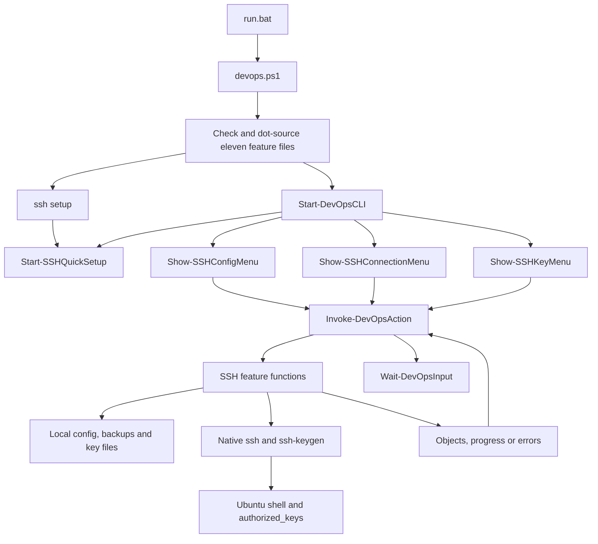

# Architecture

[Developer guide](README.md)

## Entry point and loading

`run.bat` invokes `powershell.exe -NoProfile -File` with `devops.ps1` relative to
the launcher's directory, preserves its process exit code, and pauses. It does
not select PowerShell 7, change execution policy, or interpret menu actions.

`devops.ps1` sets `ErrorActionPreference` to `Stop`, builds paths using
`PSScriptRoot`, verifies eleven named feature scripts exist, and dot-sources them
at script scope. Direct invocation starts `Start-DevOpsCLI`, or dispatches
`ssh setup` to `Start-SSHQuickSetup`. Dot-sourcing loads definitions without
starting either workflow. See [Quick Setup](ssh-quick-setup.md) for its contract.

`Import-DevOpsFunction` is defined but unused. Its inner dot-source would load
definitions only into the loader function's scope. The actual explicit
script-scope foreach loop avoids that problem. There is no module manifest,
automatic export registry, dependency container, or plugin API.

## Menu and data flow

Each menu uses a `while ($true)` loop and `switch` on `Read-Host` text. Submenu
`0` returns; main `0` returns from `Start-DevOpsCLI`. `Show-DevOpsHeader` clears
and redraws the screen. Invalid choices print a message and wait for Enter.

Configuration creation reads values into a parameter hashtable, parses the port
as an integer, and splats it to `New-SSHConfig`. Update passes only nonblank
fields to `Set-SSHConfig`; this matters because that function uses
`PSBoundParameters` to distinguish omission from a supplied value. Deletion
previews using `-WhatIf` and calls `Remove-SSHConfig -Confirm:$false` only after
an exact case-sensitive `yes` response.

Connection actions pass an alias to either the direct TCP probe or interactive
SSH function. Key actions pass a name/comment, private path, or alias/public
path. Public-key installation has a separate exact `yes` confirmation. Commands
return structured objects where implemented, and the menu renders them with
`Format-List`. Formatting belongs in the UI; preserve object output for callers.

Quick Setup automates key selection/generation, config creation/reuse, initial
login, public-key installation, and key-only verification after plan confirmation.
It preserves completed work on failure; it is not a rollback transaction.
The individual key, config, and connection actions remain available.
The Common setup-input helpers remain in the repository but are not loaded by
this menu entry point.

## Native programs and errors

Functions discover applications with `Get-Command -CommandType Application` and
invoke them using `&` with separate arguments. `ssh -G` evaluates configuration
without connecting. `Test-SSHConnection` then uses .NET `TcpClient`; it does not
authenticate. `Connect-SSH` uses native interactive SSH. Key creation/validation
uses `ssh-keygen`, including a local private-key read for pair validation.

The installer strips comments, embeds encoded public material in an LF shell
script, and sends one Base64-safe command argument to SSH. The remote shell
decodes into `sh -s`; it never evaluates user comments as shell code. See the
[reference](ssh-module.md#install-sshpublickey) and [security guide](security.md).

`Invoke-DevOpsAction` catches terminating action errors, prints their messages,
and waits for Enter. It does not rethrow or turn a caught action error into a
nonzero application process exit. Startup loading failures occur outside this
wrapper. `run.bat` preserves the process result, not a separate per-action status.
Do not use the interactive process exit code as proof that every chosen action
succeeded.

Native nonzero exits need explicit `LASTEXITCODE` checks; `try/catch` alone is
insufficient. Windows PowerShell 5.1 can also convert redirected native stderr
into an error under `Stop`. The installer explicitly handles this; other native
calls do not all have the same protection. Inspect each function's error contract
before composing it into automation.
